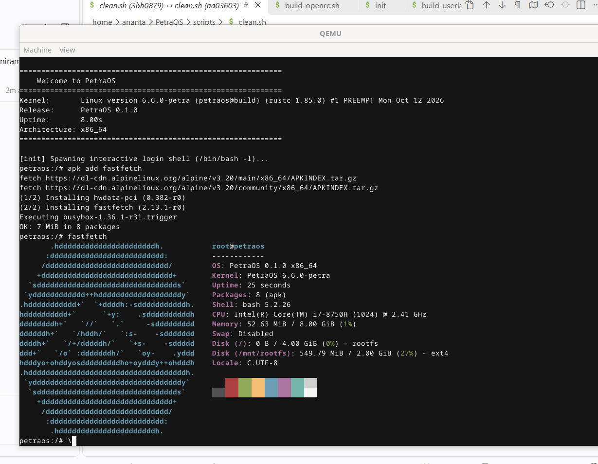

# PetraOS

A modern, modular operating system kernel written in Rust, built on OSTD (Operating System Standard Library) using Asterinas OSDK (`cargo osdk`).



---

## System Requirements & Support Status

- **Architecture**: Currently supports **x86_64** only.
- **Execution Target**: Currently runs only under the **QEMU** emulator (`cargo osdk run`).
- **Host Build System**: Currently supports **Ubuntu** only (including **Ubuntu on WSL**).

---

## Features

- **Subsystem Architecture**: Domain-partitioned kernel subsystems (`arch`, `fs`, `drivers`, `ipc`, `net`, `proc`, `sched`, `syscall`, `vm`, `time`).
- **Alpine Linux Userspace**: Powered by an Alpine Linux minirootfs userspace on the rootfs image (`musl libc`, `apk` package manager, OpenRC init system, `bash`, `python3`, `btop`).
- **Two-Tier Storage Architecture**:
  - **In-Memory Boot Initramfs** (`build/initramfs.cpio`): Lightweight CPIO archive containing the PID 1 `/init` script and minimal environment for early boot and device discovery.
  - **Persistent Rootfs Block Image** (`build/ext4.img`): Full ext4 filesystem populated from Alpine minirootfs and prebuilt package layers (including developer tools and OpenRC).
- **VFS Subsystem**: Full virtual filesystem supporting `ext4`, `exfat`, `procfs`, `sysfs`, `devfs`, `devpts`, and `tmpfs`.
- **Networking**: `AF_INET`, `AF_UNIX` (stream and datagram with `SCM_RIGHTS` & `SCM_CREDENTIALS`), and `AF_NETLINK` route socket support.

---

## Prerequisites

Before building or running PetraOS, you must first install the Asterinas OSDK and its dependencies following the official guide:

👉 **[OSDK User Guide - The Asterinas Book](https://asterinas.github.io/book/osdk/guide/index.html#install-osdk)**

### Summary of Host Requirements (Ubuntu / Ubuntu on WSL)

```bash
# 1. Install system utilities and QEMU
sudo apt update
sudo apt install -y build-essential curl git tar cpio xz-utils e2fsprogs qemu-system-x86 ovmf

# 2. Install Rust via rustup (nightly toolchain required)
curl --proto '=https' --tlsv1.2 -sSf https://sh.rustup.rs | sh -s -- -y
source "$HOME/.cargo/env"
rustup default nightly
rustup component add rust-src llvm-tools-preview

# 3. Install Asterinas OSDK
cargo install cargo-osdk
```

---

## Quick Start

### 1. Build Userland & Filesystem Images

Download the Alpine minirootfs, provision rootfs packages, and generate `build/initramfs.cpio` and `build/ext4.img`:

```bash
bash scripts/build-userland/build-userland-amd64.sh
```

### 2. Build the Kernel

Compile and check the Petra kernel via Asterinas OSDK:

```bash
export PATH="$HOME/.cargo/bin:$PATH"
cargo osdk check
cargo osdk build
```

*(Optional) You can build both userland and kernel together using:*
```bash
bash scripts/build-amd64.sh
```

### 3. Run under QEMU

Boot PetraOS in QEMU:

```bash
cargo osdk run
```

---

## Documentation

- [Userland Guide](docs/USERLAND.md): Architecture and packaging details for the Alpine-based userland and rootfs.
- [Linux Test Project (LTP) Guide](docs/LTP.md): Stress testing, system calls, scheduler, and IPC test harnesses.
- [Agent Guidelines](AGENTS.md): Architecture standards, coding principles, and human attribution guidelines.
