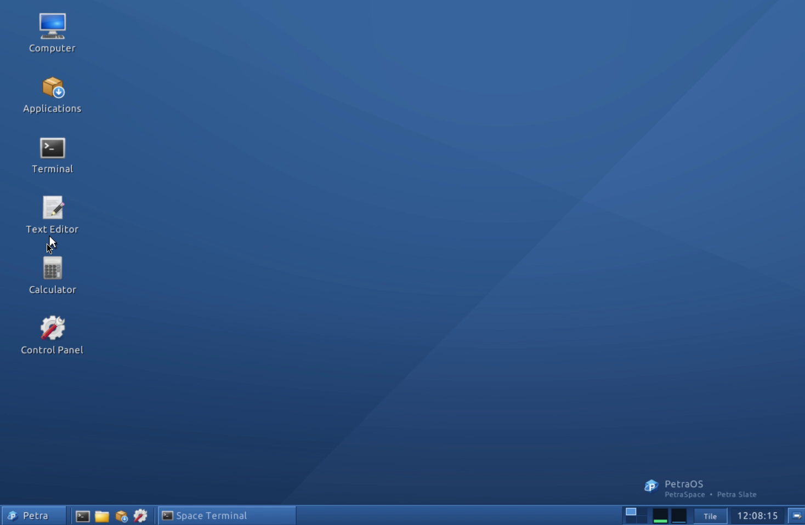

# PetraOS

A modern, modular, memory-safe operating system kernel written in Rust (`#![forbid(unsafe_code)]`), built on OSTD (Operating System Standard Library) using Asterinas OSDK (`cargo osdk`), paired with a **Void Linux (x86_64, glibc)** userspace and the native **PetraSpace** desktop environment.



---

## System Requirements & Support Status

- **Architecture**: Currently supports **x86_64** only.
- **Execution Target**: Runs under **QEMU** (`cargo osdk run` / `./scripts/run-space-amd64.sh`) and as a hybrid BIOS/UEFI ISO (`scripts/build-iso.sh`).
- **Host Build System**: Currently supports **Ubuntu** (including **Ubuntu on WSL**).
- **Minimum RAM**: Boots full kernel, console, and VirtIO-GPU stack in as little as **384 MiB RAM** (`MEM=384M` with `--release`; default QEMU config uses `8G`).

---

## Core Kernel & System Features

- **Memory-Safe Modular Kernel**: Enforces `#![forbid(unsafe_code)]` crate-wide on top of OSTD `0.19.0`, cleanly partitioned into domain subsystems (`arch`, `drivers`, `fs`, `ipc`, `modules`, `net`, `proc`, `sched`, `syscall`, `time`, `uapi`, `vdso`, `vm`).
- **Void Linux Userspace (`x86_64`, `glibc`)**: Full Void Linux glibc rootfs with `xbps` package management, `runit` service supervision, `bash`, `python3`, `gcc`/`g++`, `cmake`, `git`, `gdb`, `strace`, `htop`, and `vim`.
- **Two-Tier Storage Architecture**:
  - **In-Memory Boot Initramfs** (`build/initramfs.cpio`): Lightweight (< 2 MiB) CPIO archive containing BusyBox and the PID 1 `/init` script for early boot, pseudo-FS mounts, and rootfs handoff.
  - **Persistent Rootfs Block Image** (`build/ext4.img`): Full `ext4` filesystem populated from Void Linux glibc rootfs, prebuilt `developer-tools` package layers, and compiled PetraSpace GUI binaries.
- **Virtual File System (VFS)**: Supports `ext4`, `exfat`, `procfs`, `sysfs`, `devfs`, `devpts`, and `tmpfs` with page-cache-backed `mmap(2)`.
- **Graphics & Display**: DRM/KMS subsystem with VirtIO-GPU (`virtio-vga`), Intel/GOP framebuffer, zero-copy `GemObject` (`USegment` + `DmaStream`), and batched VirtIO 2D damage transfers.
- **Networking**: `smoltcp`-backed TCP/IP stack (`AF_INET`), `AF_UNIX` stream/datagram sockets with `SCM_RIGHTS` & `SCM_CREDENTIALS`, and `AF_NETLINK` route sockets.
- **Linux ABI & Timekeeping**: Linux-compatible syscall surface validated against LTP, EEVDF scheduler, POSIX signals/timers, `epoll`/`io_uring`, and x86_64 `linux-vdso.so.1` fast clock queries.

---

## PetraSpace Desktop Environment & UI Features

PetraSpace (`userspace/`) is PetraOS's native Rust desktop stack running directly on DRM/KMS and `/dev/input/event*` without X11 or Wayland overhead.

### Architecture (`userspace/`)

| Crate | Responsibility |
| :--- | :--- |
| `space-core` | Geometry & damage-rect coalescing, SSE2-accelerated ARGB8888 pixel blitting/alpha blending, zero-copy `/dev/shm` surfaces (`ShmSurface`) & lock-free IPC rings (`ShmRing`), dynamic SVG icon rasterizer (`resvg` + `tiny-skia`), anti-aliased TrueType font engine (`ab_glyph` with embedded Ubuntu fonts), and Void/XBPS + `runit` helpers. |
| `space-hal` | Hardware abstraction for DRM/KMS dumb buffers, VirtIO-GPU damage presentation, dynamic display mode switching, and `evdev` keyboard/mouse/tablet input. |
| `space-ui` | Retained-mode widget toolkit (`SpaceClient`, `BoxLayout`, `StylePainter`, `Theme`, `MenuBar`, `ToolBar`, `Button`, `TextInput`, `TabWidget`, `TableView`, `ScrollBar`, `Splitter`, `ProgressBar`, `StatusBar`). |
| `space-compositor` | Damage-driven compositing window manager, desktop shell, taskbar/launcher, window decorator, and workspace/layout manager. |

### Desktop & Window Manager Capabilities

- **Dual Window Management Modes**: Toggle live between **Floating** (move, resize, maximize, edge-snap left/right/top) and **Tiled** (master-stack auto-tiling) layouts via the taskbar chip or `Super+T`.
- **Virtual Workspaces**: 4 independent workspaces with a visual taskbar pager (`Super+1` .. `Super+4`).
- **Taskbar & Launcher**: Bottom taskbar featuring the Petra start menu (pinned + built-in apps), quick-launch strip, active window list with minimize/restore, live CPU/RAM usage meters, layout mode toggle, system clock, and Show Desktop button.
- **Theming & Assets**: Crisp **Petra Slate** (light) and **Petra Basalt** (dark) themes, selectable wallpaper presets, vector SVG icons (`/usr/share/icons/space/*.svg`), and anti-aliased Ubuntu Regular/Bold/Mono typography.
- **Zero-Copy Client IPC**: Apps connect over `/run/space-compositor.sock` and exchange input/damage/resize events via lock-free shared-memory rings and `mmap`'d pixel buffers.

### Keyboard Shortcuts

| Shortcut | Action |
| :--- | :--- |
| `Super + Enter` | Launch Space Terminal (`space-term`) |
| `Super + E` | Launch File Explorer (`space-files`) |
| `Super + Q` | Close the focused window |
| `Super + T` | Toggle Floating / Tiled window layout |
| `Super + 1..4` | Switch to workspace 1–4 |
| `Alt + Tab` | Open / cycle window switcher |
| `Esc` | Dismiss open launcher or menu |

### Bundled Applications (`userspace/apps/`)

| Application | Binary | Description |
| :--- | :--- | :--- |
| **Space Terminal** | `space-term` | PTY-backed interactive terminal emulator (`bash`) with ANSI/CSI escape handling and dynamic grid resizing (`TIOCSWINSZ`). |
| **File Explorer** | `space-files` | Dual-pane file manager with directory tree, navigation toolbar, file operations, and path bar. |
| **Applications Manager** | `space-apps` | Graphical Void Linux (`xbps`) software catalog to browse, search, install, and uninstall packages. |
| **Control Panel** | `space-control` | System settings hub for Display resolution/theme/wallpaper, System & Hardware info, Hostname, Audio volume, Network/DNS, Date & Time, `runit` Services, and Desktop layout. |
| **Task Manager** | `space-tasks` | Live process monitor (`/proc`) with CPU/memory stats and process termination. |
| **Calculator** | `space-calc` | Standard & scientific calculator with expression parser and history panel. |
| **Space Pad** | `space-pad` | Lightweight plain-text & code editor. |

---

## Repository Layout

| Directory | Description |
| :--- | :--- |
| `petra/src/` | Kernel source partitioned into `arch/`, `drivers/`, `fs/`, `ipc/`, `modules/`, `net/`, `proc/`, `sched/`, `syscall/`, `time/`, `uapi/`, `vdso/`, `vm/`, `utils/`. |
| `userspace/` | PetraSpace GUI workspace (`space-core`, `space-hal`, `space-ui`, `space-compositor`, and `apps/*`). |
| `base-files/` | Initramfs `/init`, rootfs config overlays, `runit` service definitions, and SVG icon theme (`/usr/share/icons/space/`). |
| `scripts/` | Build, userland assembly, QEMU runner, ISO generator, and LTP test scripts. |
| `docs/` | Technical guides, performance logs, security audits, and architecture research. |

---

## Prerequisites

Before building or running PetraOS, install Asterinas OSDK and host dependencies following the official guide:

👉 **[OSDK User Guide - The Asterinas Book](https://asterinas.github.io/book/osdk/guide/index.html#install-osdk)**

### Host Requirements (Ubuntu / Ubuntu on WSL)

```bash
# 1. Install system utilities and QEMU
sudo apt update
sudo apt install -y build-essential curl git tar cpio xz-utils e2fsprogs qemu-system-x86 ovmf

# 2. Install Rust via rustup (nightly toolchain required)
curl --proto '=https' --tlsv1.2 -sSf https://sh.rustup.rs | sh -s -- -y
source "$HOME/.cargo/env"
rustup default nightly
rustup component add rust-src llvm-tools-preview
rustup target add x86_64-unknown-linux-gnu

# 3. Install Asterinas OSDK
cargo install cargo-osdk
```

---

## Quick Start

### 1. Build Userland, PetraSpace UI & Filesystem Images

Downloads the Void Linux glibc rootfs, provisions XBPS `developer-tools`, compiles all PetraSpace GUI binaries in release mode (`userspace/`), and generates `build/initramfs.cpio` and `build/ext4.img`:

```bash
bash scripts/build-userland/build-userland-amd64.sh
```

*(Pass `--fresh` to rebuild staging from scratch, or `--fresh --purge-cache` to re-download Void Linux archives.)*

### 2. Build the Kernel

Compile and check the Petra kernel via Asterinas OSDK:

```bash
export PATH="$HOME/.cargo/bin:$PATH"
cargo osdk check
cargo osdk build
```

*(Optional) Build userland, kernel, and a bootable hybrid BIOS/UEFI ISO together:*

```bash
bash scripts/build-amd64.sh --release
```

### 3. Run PetraOS in QEMU

**Boot directly into the PetraSpace GUI (recommended):**

```bash
./scripts/run-space-amd64.sh
```

Useful flags for `run-space-amd64.sh`:
- `--no-build`: Skip checking/assembling userland and boot existing images directly.
- `--release`: Boot the release kernel build (smaller ELF, faster graphics, lower RAM footprint).

Or invoke OSDK directly with the GUI boot parameter:

```bash
cargo osdk run --kcmd-args="PETRA_BOOT_GUI=1"
```

**Boot into the Void Linux interactive shell (CLI mode):**

```bash
cargo osdk run
```

---

## Compiling & Iterating on PetraSpace UI

When developing inside `userspace/`, you can compile and unit-test PetraSpace standalone before repacking `build/ext4.img`:

```bash
export PATH="$HOME/.cargo/bin:$PATH"

# 1. Run host unit tests for space-core, space-ui, and apps
(cd userspace && cargo test --workspace)

# 2. Compile all PetraSpace GUI binaries (compositor + 7 apps) in release mode
(cd userspace && cargo build --release --target x86_64-unknown-linux-gnu)

# 3. Install updated binaries into rootfs staging and repack build/ext4.img + initramfs.cpio
bash scripts/build-userland/build-userland-amd64.sh

# 4. Boot directly into PetraSpace GUI
./scripts/run-space-amd64.sh --no-build
```

---

## QEMU Configuration & Build Utilities

`scripts/qemu_args.sh` supports overriding QEMU parameters via environment variables:

| Variable | Default | Description |
| :--- | :--- | :--- |
| `MEM` | `8G` | Guest RAM size (e.g., `MEM=512M` or `MEM=4G`) |
| `SMP` | `4` | Number of virtual CPU cores |
| `ENABLE_KVM` | `on` | Enable KVM hardware acceleration when `/dev/kvm` exists |
| `VIRTIO_GPU_XRES` / `YRES` | `1920` / `1080` | Initial VirtIO-GPU display resolution |
| `DISPLAY_MODE` | `std` | QEMU display backend (`std`, `none`, `vnc`, etc.) |
| `SERIAL` | `stdio` | Serial console output (`stdio`, `file`, `none`) |

Additional utility scripts:
- **Repack images only**: `bash scripts/build-initramfs.sh`
- **Build bootable ISO**: `bash scripts/build-iso.sh`
- **Clean build artifacts**: `bash scripts/clean.sh`

---

## Testing & Verification

```bash
export PATH="$HOME/.cargo/bin:$PATH"

# Kernel compile & check
cargo osdk check
cargo osdk build

# Kernel unit tests (ktest in QEMU)
cargo osdk test

# PetraSpace userspace unit tests
(cd userspace && cargo test --workspace)

# Linux Test Project (LTP) syscall conformance suite
bash scripts/linux-test-project/test-syscalls.sh
```

---

## Documentation

- [Userland Guide](docs/USERLAND.md): Void Linux glibc rootfs architecture, XBPS package layers, and image generation.
- [Linux Test Project (LTP) Guide](docs/LTP.md): Running Linux ABI conformance and stress tests across syscalls, scheduler, and IPC.
- [Graphics, Console & Memory Performance Log](docs/PERF.md): Benchmarks for lock-free framebuffer console, zero-copy GEM, VirtIO-GPU DMA batching, and low-RAM (< 500 MiB) boot.
- [Kernel Security Audit & Remediation History](docs/SECURITY_AUDIT.md): Security audit findings, privilege boundary checks, and `#![forbid(unsafe_code)]` hardening.
- [Hypervisor & Safe Driver Research](docs/HYPERVISOR_RESEARCH.md): OSTD `0.19.0` VT-x/EPT hypervisor roadmap and safe device model notes.
- [Agent Guidelines](AGENTS.md): Architectural standards, subsystem boundaries, coding principles, and contributor workflow.
