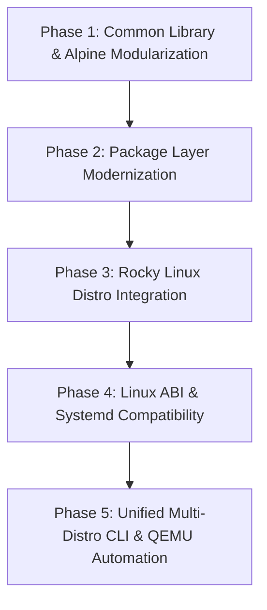

# PetraOS Multi-Distro Implementation Plan (Alpine & Rocky Linux)

## Executive Summary
This document establishes the architectural and engineering blueprint to evolve PetraOS from a single, tightly-coupled Alpine Linux initramfs into a modular, multi-distribution operating system capable of running both **Alpine Linux** (musl + BusyBox/OpenRC) and **Rocky Linux** (glibc + systemd) as separate userland distributions.

The plan is divided into phases with a clean, modular directory structure for scripts, userspace assembly, and kernel ABI readiness.

---

## 1. Architectural Strategy

```
                          +-----------------------------------+
                          |      PetraOS Kernel (silica)      |
                          |  Linux ABI Layer (Syscall Ledger) |
                          +-----------------+-----------------+
                                            |
              +-----------------------------+-----------------------------+
              |                                                           |
              v                                                           v
+-----------------------------+                           +-----------------------------+
|    Distro Target: Alpine    |                           |     Distro Target: Rocky    |
|                             |                           |                             |
| • C-Lib: musl               |                           | • C-Lib: glibc              |
| • Init: /bin/sh or OpenRC   |                           | • Init: systemd (or bash)   |
| • Package Mgr: apk          |                           | • Package Mgr: dnf / rpm    |
| • Primary Target: initramfs |                           | • Primary Target: AHCI disk |
| • Use Case: Rescue/Dev tool |                           | • Use Case: Enterprise apps |
+-----------------------------+                           +-----------------------------+
```

### Core Design Tenets
1. **Separation of Concerns**: Kernel build (`cargo osdk`), filesystem image packaging, distro recipes, and common utilities are strictly isolated.
2. **Zero Host Pollution**: Distribution rootfs extraction and package injection should run with minimal host dependencies (utilizing statically compiled tools or container runtimes if present, falling back to standalone extractors).
3. **Plug-and-Play Distros**: Adding a new distro (e.g. Debian or Arch) in the future should require adding a single self-contained directory under `scripts/distros/<name>/`.

---

## 2. Target Modular Directory Structure

All scripts will follow this clean, maintainable layout:

```text
scripts/
├── build.sh                         # Top-level unified orchestrator CLI
├── clean.sh                         # Unified cache & build artifact cleaner
│
├── common/                          # Shared shell libraries (DRY)
│   ├── env.sh                       # Repository paths, architecture defaults
│   ├── log.sh                       # Color-coded logging (info, warn, error, step)
│   └── util.sh                      # Hash checks, retry downloads, tool verify
│
├── distros/                         # Distro-specific recipes
│   ├── alpine/
│   │   ├── config.env               # Versions, branch, mirror URLs, sha256
│   │   ├── fetch.sh                 # Download & verify minirootfs & apk.static
│   │   ├── build.sh                 # Assemble rootfs into staging
│   │   └── init/                    # Alpine init scripts
│   │       └── init                 # Minimal PID 1 shell bootstrap
│   │
│   └── rocky/
│       ├── config.env               # Rocky version, container base URL, sha256
│       ├── fetch.sh                 # Download & verify Rocky container base
│       ├── build.sh                 # Assemble Rocky rootfs, glibc libs, userland
│       └── init/
│           ├── init                 # Rocky PID 1 or switch-root script
│           └── petra-setup.service  # Custom systemd unit for hardware setup
│
├── packages/                        # Distro-agnostic layer definitions
│   └── developer-tools/
│       ├── packages.alpine          # Package list for Alpine (apk)
│       ├── packages.rocky           # Package list for Rocky (rpm/dnf)
│       └── install.sh               # Dispatcher to distro package manager
│
├── images/                          # Image generation & disk formatters
│   ├── build-initramfs.sh           # Packs staging dir into newc CPIO archive
│   ├── build-disk.sh                # Generates EXT4 / exFAT block images
│   └── build-iso.sh                 # Hybrid BIOS/UEFI bootable ISO
│
└── support/                         # Shared assets & configs
    ├── fastfetch.jsonc
    └── petraos-logo.txt
```

---

## 3. Phased Implementation Roadmap



### Phase 1: Common Library & Alpine Modularization
**Goal**: Decouple the existing monolithic `build-userland-amd64.sh` without breaking current testing.
- **Tasks**:
  1. Create `scripts/common/env.sh`, `scripts/common/log.sh`, and `scripts/common/util.sh`.
  2. Move Alpine-specific logic to `scripts/distros/alpine/`:
     - `config.env`: Define `ALPINE_VERSION=3.20.3`, `ALPINE_BRANCH=v3.20`, and SHA256 checksums.
     - `fetch.sh`: Dedicated cache downloader with retry and checksum validation.
     - `build.sh`: Unpack minirootfs, configure `/etc/resolv.conf`, `/etc/hosts`, and base user setup.
     - `init/init`: Move `/init` script into Alpine's distro folder.
  3. Relocate image builders to `scripts/images/`:
     - `build-initramfs.sh`
     - `build-disk.sh`
     - `build-iso.sh`
  4. Verify compilation and boot: `cargo osdk run` must continue to boot successfully.

### Phase 2: Package Layer Modernization (`developer-tools`)
**Goal**: Make package layers work across different distribution package managers.
- **Tasks**:
  1. Split `packages/developer-tools/` into declared package manifests:
     - `packages.alpine`: `autoconf`, `bash`, `build-base`, `cmake`, `e2fsprogs`, `fastfetch`, `git`, `make`, `vim`, etc.
     - `packages.rocky`: `coreutils`, `bash`, `make`, `gcc`, `cmake`, `git`, `vim-enhanced`, `tmux`, `fastfetch`, etc.
  2. Create a unified package installer:
     ```bash
     scripts/packages/developer-tools/install.sh --distro <alpine|rocky> --root <staging_dir>
     ```
  3. Implement Rocky installer engine:
     - **Mode A (Host has DNF/RPM)**: Use `dnf --installroot=<dir> --releasever=9 -y install <packages...>`.
     - **Mode B (Container Runtime Available)**: Use `docker` or `podman` to run `dnf --installroot` mapped to the staging volume.
     - **Mode C (Standalone fallback)**: Unpack targeted RPM packages via `rpm2cpio`.

### Phase 3: Rocky Linux Distro Integration
**Goal**: Create a fully functioning Rocky Linux rootfs for PetraOS.
- **Tasks**:
  1. Add `scripts/distros/rocky/config.env`:
     - Pinned release: Rocky Linux 9 Minimal/Base container rootfs (`dl.rockylinux.org`).
  2. Implement `scripts/distros/rocky/fetch.sh`:
     - Download and verify `Rocky-9-Container-Base.latest.x86_64.tar.xz`.
  3. Implement `scripts/distros/rocky/build.sh`:
     - Extract base rootfs.
     - Configure `/etc/os-release` for PetraOS (Rocky Linux Userspace).
     - Configure PAM, `/etc/securetty`, root password/empty password console login.
     - Generate an EXT4 filesystem image (`build/rocky-rootfs.img`) sized to fit (e.g. 1.2 GB - 2 GB).

### Phase 4: Linux ABI & Systemd Compatibility (Kernel Layer)
**Goal**: Enable PetraOS's `silica` kernel to boot Rocky Linux through `systemd` or interactive bash.
- **Kernel Gaps to Address**:
  1. **Missing Filesystem System Calls**:
     - Implement / fix `symlinkat` (#266), `readlinkat` (#267), and `unlinkat` (#263).
     - Add `statx` (#332) required by modern glibc.
  2. **Event & Notification Subsystem**:
     - Implement `signalfd4` (#289) for `systemd` event loops.
     - Implement `timerfd_create` (#283), `timerfd_settime` (#286), and `timerfd_gettime` (#287).
     - Implement `eventfd2` (#290) and `pidfd_open` (#434).
  3. **Process & Thread Primitives**:
     - Handle `clone3` (#435) with fallback or native decode.
     - Implement `prctl` sub-commands: `PR_SET_NAME`, `PR_GET_NAME`, `PR_SET_CHILD_SUBREAPER`.
     - Expand `futex` operations to support bitsets and realtime clocks.
  4. **Pseudo-Filesystem Virtualization**:
     - Provide minimal `cgroupv2` filesystem mount point at `/sys/fs/cgroup`.
     - Emulate `/proc/self/stat`, `/proc/self/status`, `/proc/cmdline`, `/proc/uptime`.

### Phase 5: Unified Master CLI & QEMU Orchestration
**Goal**: Seamless developer workflow for switching distributions during testing.
- **Tasks**:
  1. Implement `scripts/build.sh`:
     ```bash
     # Build Alpine target (default)
     ./scripts/build.sh --distro alpine

     # Build Rocky Linux target
     ./scripts/build.sh --distro rocky

     # Build everything
     ./scripts/build.sh --all
     ```
  2. Update `tools/qemu_args.sh` to support selecting the boot disk or initramfs:
     ```bash
     DISTRO=rocky cargo osdk run
     ```
  3. Support dual-boot / switch-root in PetraOS init script:
     - Detect boot parameter `petraos.distro=rocky` vs `petraos.distro=alpine`.
     - If Rocky is selected and `/dev/sda` holds the Rocky rootfs, mount `/dev/sda` and execute `/usr/lib/systemd/systemd` or `/bin/bash`.

---

## 4. Maintenance and Validation Checklist

For every distribution added or modified, verify:
- [ ] `cargo osdk check` passes without warnings.
- [ ] `cargo osdk build` compiles the kernel successfully.
- [ ] `./scripts/clean.sh --distro <name>` cleanly removes intermediate rootfs and cache without affecting other distros.
- [ ] Base init boots cleanly to a login prompt / shell (`/bin/sh` or `systemd`).
- [ ] Terminal colors, fastfetch, and console devices (`/dev/tty`, `/dev/console`, `/dev/pts`) function correctly.
- [ ] All commits comply with human author attribution standards.
