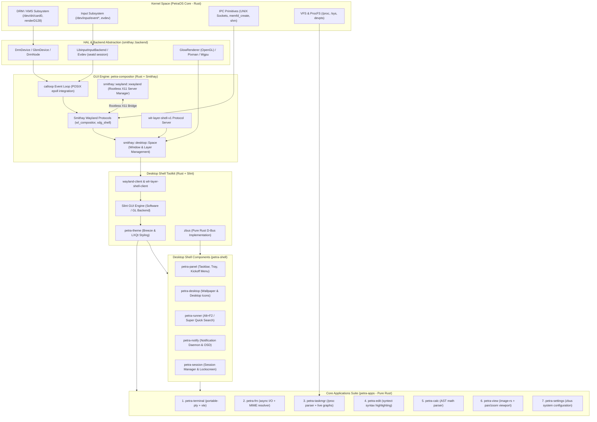
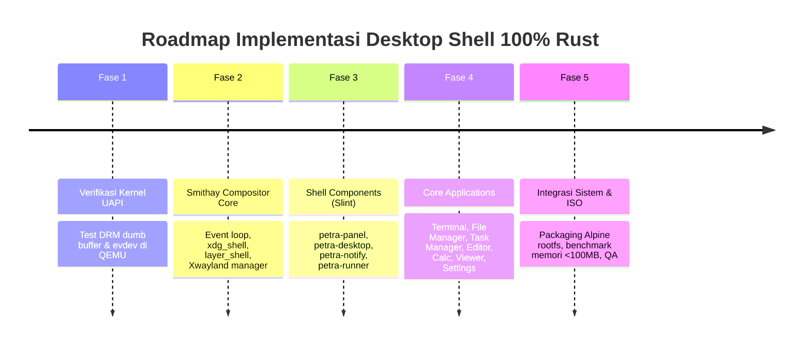

# PetraOS Desktop Shell: 100% Rust Architecture & Implementation Specification

Dokumen spesifikasi dan implementasi teknis untuk membangun **Desktop Shell** yang 100% berbasis **Rust**, modular, dan berperforma tinggi pada **PetraOS**. Arsitektur ini dirancang menggunakan **Smithay** sebagai fondasi GUI Engine / Wayland Compositor, toolkit UI berbasis Rust (**Slint**) yang mengusung estetika perpaduan **KDE Plasma** dan **LXQt**, kompatibilitas ganda **Wayland + X11 (via Xwayland)**, serta separasi ketat antara *kernel space* dan *userspace*.

---

## 1. Visi Desain & Prinsip Arsitektur (100% Rust)

### 1.1 Filosofi Stack (Memory-Safe, Zero-Overhead, Modern)
- **100% Rust Ecosystem**: Menyelaraskan seluruh stack desktop dengan arsitektur kernel PetraOS (Rust). Menjamin *memory safety*, *thread safety* bebas data race, tidak ada ketergantungan runtime C++ yang besar (seperti glib/Qt runtime yang berat), dan menghasilkan static/dynamic binary yang sangat ramping.
- **Ringan & Responsif (Inspirasi LXQt)**:
  - Footprint memori sangat kecil: Compositor + Shell idle < 80–120 MB RAM.
  - Startup instan (< 100ms cold boot userspace shell).
  - Konsumsi CPU mendekati 0% saat idle (event-driven asynchronous loop via `calloop` dan `tokio`).
- **Elegan & Terstruktur (Inspirasi KDE Plasma)**:
  - Gaya visual *Breeze-like*: Flat visual design, sudut *rounded* halus (border radius 6–8px), bayangan lembut (*soft drop shadows*), aksen warna dinamis, dan tipografi jernih (*Inter* / *Noto Sans*).
  - Elemen shell: Panel bawah terintegrasi (Taskbar, App Launcher bergaya Kickoff, System Tray/SNI, Clock & Quick Settings flyout), KRunner-style search launcher, serta Desktop canvas untuk wallpaper dan ikon.
- **Pemisahan Proses (Decoupled Components)**:
  - Setiap komponen shell (panel, desktop, runner, notifications) berjalan sebagai proses userspace mandiri yang berkomunikasi melalui protokol Wayland (`wlr-layer-shell`) dan D-Bus IPC (`zbus`).

### 1.2 Prinsip Clean Code & Software Engineering
- **Domain-Driven Modularization**: Pemisahan tegas per layer (Kernel UAPI -> HAL Backend -> Compositor Core -> Shell Components -> Core Applications).
- **Rust Idioms & Zero-Panic Policy**:
  - Larangan mutlak pemanggilan `.unwrap()` atau `.expect()` pada daemon loop.
  - Error handling eksplisit berbasis `thiserror` dan `anyhow`.
  - Logging dan instrumentasi terstruktur berbasis `tracing` dan `tracing-subscriber`.
  - Penggunaan Trait abstrak untuk rendering (`Renderer`, `Frame`) dan input backend (`InputBackend`).

---

## 2. Peta Arsitektur Sistem (Layered 100% Rust Stack)



---

## 3. Rincian Pemisahan Modul & Interaksi Kernel - Userspace

### 3.1 Kernel Space vs Userspace Boundary
Interaksi antara userspace Rust dan kernel PetraOS sepenuhnya mengacu pada POSIX/Linux UAPI:
1. **DRM / KMS Subsystem (`/dev/dri/card0`, `/dev/dri/renderD128`)**:
   - `ioctl(DRM_IOCTL_MODE_GETRESOURCES)`: Query konektor layar, CRTC, encoder, dan resolusi yang tersedia.
   - `ioctl(DRM_IOCTL_MODE_CREATE_DUMB)`: Alokasi framebuffer dumb buffer untuk software rendering (zero GPU dependency).
   - `ioctl(DRM_IOCTL_PRIME_HANDLE_TO_FD)`: Ekspor buffer handle menjadi `dma-buf` file descriptor untuk zero-copy GPU memory sharing (VirtIO-GPU).
   - `ioctl(DRM_IOCTL_MODE_PAGE_FLIP)`: Pengiriman page-flip event sinkron ke VSync.
2. **Input Subsystem (`/dev/input/event*`)**:
   - Polling event melalui `epoll`/`poll` pada descriptor evdev.
   - Parsing struktur standar `input_event` (Key, Motion, Absolute, Sync).
   - Integrasi hak akses dan VT switching melalui `seatd` (Seat Daemon).
3. **Inter-Process Communication (IPC) & Shared Buffers**:
   - `memfd_create` / `shm_open`: Alokasi memori bersama anonim antara klien Wayland dan Compositor.
   - `AF_UNIX` Sockets: Soket Wayland (`/run/user/1000/wayland-0`) dan D-Bus session/system bus socket (`/run/user/1000/bus`).
4. **Virtual File Systems (`/proc`, `/sys`, `/dev`)**:
   - `/proc/[pid]/stat`, `/proc/meminfo`, `/proc/loadavg` untuk pemantauan sistem oleh task manager.
   - `/dev/ptmx` & `/dev/pts/*` untuk PTY (pseudo-terminal) emulator.

---

### 3.2 GUI Engine: Compositor Berbasis Smithay (`petra-compositor`)
Menggunakan **Smithay** (framework compositor Wayland murni Rust) memberikan arsitektur yang kokoh, modular, dan aman:

1. **Backend Handling (`smithay::backend`)**:
   - **DRM Backend**: Menangani KMS modesetting, atomic commit, dan CRTC control.
   - **Gbm / Egl Backend**: Pengelolaan buffer GPU grafis jika akselerasi VirtIO-GPU aktif.
   - **Renderer Engine**:
     - *Primary*: `GlowRenderer` (OpenGL ES 2.0 / 3.0 via Mesa / virgl).
     - *Fallback*: `PixmanRenderer` (100% software CPU rendering, aman berjalan di sembarang VM atau hardware tanpa driver GPU).
   - **Input Backend**: `LibinputInputBackend` menangani keyboard, mouse pointer, dan touchpad gesture.
2. **Wayland Protocols & Extensions (`smithay::wayland`)**:
   - Protokol Dasar: `wl_compositor`, `wl_subcompositor`, `wl_shm`, `wl_seat`, `wl_output`, `wl_data_device`.
   - Desktop Shell: `xdg_shell` untuk aplikasi window konvensional.
   - Layer Shell: `wlr-layer-shell-unstable-v1` untuk mengunci panel ke tepi bawah, desktop ke latar belakang, dan notifikasi ke sudut layar.
   - Keamanan: `ext-session-lock-v1` untuk lockscreen aman yang tidak dapat dilewati atau bocor inputnya.
3. **Subsystem Kompatibilitas X11 (Xwayland)**:
   - Dikelola melalui `smithay::wayland::xwayland::XWayland`.
   - Meluncurkan binary `Xwayland :0 -rootless` secara dinamis saat ada aplikasi X11 yang terdeteksi.
   - Menerjemahkan window X11 menjadi permukaan Wayland (`X11Surface`) yang dikelola oleh window manager Smithay.

---

### 3.3 GUI Toolkit & Theming Framework (Rust + Slint)
Untuk membangun antarmuka pengguna (UI) yang memiliki estetika KDE Plasma + LXQt:
- **Mengapa Slint?**:
  - Dibuat khusus dengan Rust, bahasa deklaratif modern (`.slint`), di-compile menjadi kode Rust statis berkecepatan tinggi.
  - Footprint memori per aplikasi hanya berkisar **10–18 MB RAM** (jauh lebih ringan dari Qt6 yang memakan 60–100 MB per proses).
  - Mendukung software rendering langsung (`Slint Software Renderer`) dan GPU (`Femtovg / Skia / OpenGL`).
- **Tema `petra-theme.slint`**:
  - **Palet Warna Breeze**: Slate Blue (`#2980b9`), Charcoal Grey (`#232629` dark) / Crisp Paper White (`#eff0f1` light), Accent Cyan (`#1cdc9a`).
  - **Kerapian LXQt**: Flat controls, border 1px subtle, spacing padat dan teratur, tidak ada animasi berat yang membuang siklus CPU.

---

## 4. Rincian Komponen Desktop Shell (`petra-shell`)

| Komponen Shell | Tanggung Jawab & Fitur Utama | Protokol / Crate Rust |
| :--- | :--- | :--- |
| **`petra-panel`** | Taskbar bawah (tinggi 36px): Tombol Start Kickoff, window list dengan preview tooltip, workspace switcher, system tray (StatusNotifierItem), jam & kalender popout, serta quick settings (slider volume & brightness). | `wlr-layer-shell`, `slint`, `zbus` (SNI watcher) |
| **`petra-desktop`** | Menangani wallpaper desktop (stretch/fit), grid ikon desktop, drag-and-drop, dan menu klik kanan (Create Folder, Open Terminal, Display Settings). | `wlr-layer-shell` (Layer: Background), `slint` |
| **`petra-runner`** | Modal pop-up pencarian cepat (`Alt+Space` atau tombol `Super`): pencarian aplikasi `.desktop`, kalkulator ekspresi instan, dan eksekusi command shell. | `wlr-layer-shell` (Layer: Overlay), `slint` |
| **`petra-notify`** | Daemon notifikasi desktop: Menampilkan popup toast di sudut kanan atas dengan timeout otomatis, tombol aksi, serta slider OSD saat volume atau kecerahan layar berubah. | D-Bus service `org.freedesktop.Notifications`, `zbus`, `slint` |
| **`petra-session`** | Session coordinator: Autostart aplikasi dari `/etc/xdg/autostart`, manajemen idle timeout, dialog shutdown/reboot/logout, dan lockscreen. | `ext-session-lock-v1`, `zbus` |

---

## 5. Spesifikasi 7 Aplikasi Bawaan (100% Pure Rust)

Seluruh aplikasi dibuat sebagai crate mandiri dalam workspace `userspace/apps/` menggunakan **Rust + Slint**:

### 1. Terminal (`petra-terminal`)
- **Backend PTY**: `portable-pty` mengelola master/slave PTY di `/dev/ptmx`.
- **Parser Escape Code**: `vte` crate (parser ANSI/VT100 state machine berperforma tinggi).
- **Fitur**: Multi-tab, split horizontal/vertikal, font custom (*JetBrains Mono* / *Fira Code*), dukungan TrueColor 24-bit, clipboard terintegrasi.

### 2. File Manager (`petra-fm`)
- **I/O Asinkron**: Berbasis `tokio::fs` agar UI tidak pernah freeze saat menyalin file berukuran besar.
- **Fitur**: Dual-pane (F3), sidebar akses cepat (Home, Downloads, Documents, Mounted Disks), MIME-type association via `xdg_mime`, tampilan Icon Grid dan Detail List, dialog copy/move/delete dengan progress bar.

### 3. Task Manager (`petra-taskmgr`)
- **Engine Data**: Membaca dan mem-parsing langsung `/proc/stat`, `/proc/meminfo`, `/proc/[pid]/*` tanpa alokasi memori berlebih.
- **Fitur**: Visualisasi grafik CPU (per-core), RAM, Swap, Disk I/O, Network history 60 detik. Tabel proses dengan hierarki pohon (parent-child), pencarian proses, pengurutan kolom, dan pengiriman sinyal (`SIGTERM`, `SIGKILL`, `SIGSTOP`).

### 4. Notepad / Text Editor (`petra-edit`)
- **Syntax Highlighting**: Menggunakan crate `syntect` (mendukung Rust, C/C++, Shell, Python, Markdown, JSON, YAML).
- **Fitur**: Tab dokumen ganda, nomor baris, pencarian teks (Regex support), indentasi otomatis, deteksi encoding UTF-8, line-ending selector (LF/CRLF).

### 5. Calculator (`petra-calc`)
- **Engine Evaluasi**: Crate `evalexpr` atau parser Pratt kustom untuk kalkulasi ekspresi matematis aman.
- **Fitur**: Mode Standar dan Mode Saintifik (trigonometri, eksponen, logaritma, faktorial), histori kalkulasi interaktif, presisi desimal tinggi, keyboard input binding.

### 6. Image Viewer (`petra-view`)
- **Decoder Gambar**: Crate `image` (mendukung PNG, JPEG, WebP, BMP, GIF, SVG).
- **Fitur**: Navigasi pan & smooth zoom, rotasi 90° searah/berlawanan jarum jam, flip horizontal/vertikal, tombol Next/Previous untuk file dalam folder yang sama, inspeksi metadata EXIF dasar via `kamadak-exif`.

### 7. Settings / Control Panel (`petra-settings`)
- **Backend Komunikasi**: Modul kontrol berbasis D-Bus (`zbus`) dan pembacaan konfigurasi XDG (`~/.config/petra/`).
- **Modul**:
  - *Display*: Resolusi, refresh rate, scaling, layout monitor (protokol `wlr-output-management`).
  - *Appearance*: Dark / Light theme toggle, warna aksen, wallpaper, font system.
  - *Input*: Kecepatan pointer mouse, akselerasi, layout keyboard, repeat rate.
  - *Audio*: Pengaturan volume master, seleksi input/output sink.
  - *Date & Time*: Jam sistem, sinkronisasi NTP, format 12h/24h.
  - *About*: Kernel PetraOS info, CPU, memori, logo sistem, uptime.

---

## 6. Struktur Direktori Workspace Monorepo

```
PetraOS/
├── petra/                          # [Kernel Space] PetraOS Rust Kernel
│   └── src/
│       ├── drivers/drm/            # DRM/KMS drivers
│       └── drivers/input/          # Evdev, uinput, input drivers
│
├── spec-shell/                     # [Spesifikasi & Rencana Desain Shell]
│   └── README.md                   # Dokumen spesifikasi lengkap (uncommitted)
│
├── userspace/                      # [Userspace Stack - 100% Rust Cargo Workspace]
│   ├── Cargo.toml                  # Workspace root definition
│   │
│   ├── libs/                       # Internal Shared Crates
│   │   ├── petra-uapi/             # Rust safe binding ke UAPI PetraOS/Linux
│   │   ├── petra-theme/            # Shared Slint styling, colors, assets
│   │   └── petra-ipc/              # Wrapper zbus D-Bus interfaces
│   │
│   ├── compositor/                 # [GUI Engine]
│   │   ├── Cargo.toml
│   │   └── src/
│   │       ├── backend/            # Smithay DRM, KMS, Libinput & Pixman backends
│   │       ├── protocols/          # XDG shell, Layer shell, Session lock
│   │       ├── xwayland/           # Xwayland integration manager
│   │       ├── state.rs            # Compositor global state
│   │       └── main.rs             # Daemon executable (petra-compositor)
│   │
│   ├── shell/                      # [Desktop Shell Components]
│   │   ├── panel/                  # petra-panel (Taskbar, Systray, Kickoff)
│   │   ├── desktop/                # petra-desktop (Wallpaper, Icons)
│   │   ├── runner/                 # petra-runner (App search)
│   │   ├── notify/                 # petra-notify (Notifications & OSD)
│   │   └── session/                # petra-session (Session manager)
│   │
│   └── apps/                       # [Core Applications Suite]
│       ├── terminal/               # petra-terminal
│       ├── filemanager/            # petra-fm
│       ├── taskmanager/            # petra-taskmgr
│       ├── editor/                 # petra-edit
│       ├── calculator/             # petra-calc
│       ├── imageviewer/            # petra-view
│       └── settings/               # petra-settings
│
└── scripts/
    ├── build-desktop/              # Script build & packaging desktop stack
    └── build-userland/             # Penggabungan ke dalam rootfs/initramfs
```

---

## 7. Tahapan Implementasi & Roadmap Eksekusi



### Fase 1: Validasi Fondasi Kernel & Backend (Minggu 1 - 2)
- [ ] Verifikasi driver DRM/KMS: membuka `/dev/dri/card0`, alokasi dumb buffer, atomic modesetting di QEMU.
- [ ] Verifikasi driver input: pembacaan event keyboard & mouse melalui `/dev/input/event*`.
- [ ] Uji coba executable Rust mandiri yang merender buffer langsung via dumb buffer tanpa display server.

### Fase 2: Pembangunan Compositor Berbasis Smithay (Minggu 3 - 5)
- [ ] Setup crate `userspace/compositor` dengan dependensi `smithay = "0.3"`.
- [ ] Implementasikan event loop `calloop` terintegrasi dengan backend DRM dan Libinput.
- [ ] Implementasikan rendering pipeline dengan `PixmanRenderer` (software) dan `GlowRenderer` (OpenGL).
- [ ] Registrasi protokol Wayland: `wl_compositor`, `xdg_shell`, `wlr-layer-shell-unstable-v1`, dan `ext-session-lock-v1`.
- [ ] Aktifkan `Xwayland` server bridge untuk kompatibilitas penuh aplikasi X11.

### Fase 3: Desktop Shell Components Berbasis Slint (Minggu 6 - 8)
- [ ] Definisikan tema sentral `petra-theme.slint` dengan gaya visual Breeze/LXQt.
- [ ] Bangun `petra-panel` menggunakan `wlr-layer-shell`:
  - Start Menu (Kickoff) dengan parser `.desktop`.
  - Taskbar dengan preview window dan task switcher.
  - System Tray melalui D-Bus `StatusNotifierWatcher` (`zbus`).
- [ ] Bangun `petra-desktop` untuk wallpaper dan ikon.
- [ ] Bangun `petra-notify` untuk popup notifikasi dan OSD.
- [ ] Bangun `petra-runner` untuk pencarian aplikasi cepat via `Alt+Space`.

### Fase 4: Core Applications Suite (Minggu 9 - 12)
- [ ] **petra-terminal**: Integrasi `portable-pty`, parser ANSI `vte`, dan tab UI.
- [ ] **petra-taskmgr**: Parser zero-allocation untuk `/proc`, grafik pemantauan real-time.
- [ ] **petra-fm**: Asynchronous I/O file explorer, dual-pane, icon/detail view.
- [ ] **petra-edit**: Text editor dengan syntax highlighting `syntect`.
- [ ] **petra-calc**: Kalkulator standar & saintifik berbasis parser ekspresi `evalexpr`.
- [ ] **petra-view**: Image viewer multiformat dengan zoom/pan viewport.
- [ ] **petra-settings**: Control Panel modular terintegrasi dengan konfigurasi sistem.

### Fase 5: Integrasi ISO, Pengujian & Quality Assurance (Minggu 13 - 14)
- [ ] Integrasikan seluruh biner ke dalam pipeline `scripts/build-userland/build-userland-amd64.sh`.
- [ ] Konfigurasi auto-start sesi pada init (`/init` atau OpenRC service `petra-session`).
- [ ] Verifikasi konsumsi RAM idle (target: < 100 MB).
- [ ] Audit kode sesuai standar PetraOS tanpa melakukan git commit sebelum persetujuan pengguna.
